<div align="center">

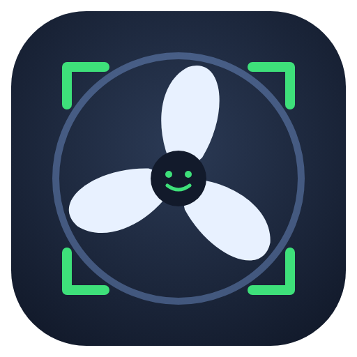

# ELEGOO Mega 2560 Face Fan (OpenCV)

**A desk fan that follows your face.**

[](https://github.com/PhamAnhHoangg/ELEGOO-2560-fan-OpenCV/actions/workflows/ci.yml)
[](https://github.com/PhamAnhHoangg/ELEGOO-2560-fan-OpenCV/releases)
[](LICENSE)

[Parts](#parts) · [Wiring](#wiring) · [Setup](#setup) · [How it works](#how-it-works) · [Troubleshooting](#troubleshooting) · [Versions](#versions)

</div>

The laptop webcam finds your face with
OpenCV, and Python sends its position over USB to an ELEGOO Mega 2560. The
Mega turns a servo to point the fan at you, and spins the fan through an
L293D motor driver: full speed when you're far away, a gentle breeze when
you're close. If nobody is around, the fan stops and looks forward again.

| The camera finds the face | The fan follows |
|:---:|:---:|
| [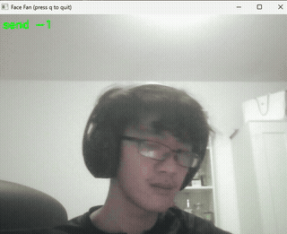](media/demo_camera.mp4) | [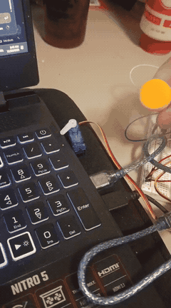](media/demo_fan.mp4) |
| [Full video (mp4)](media/demo_camera.mp4) | [Full video (mp4)](media/demo_fan.mp4) |

> **About the demo:** I had no way to attach the motor to the servo horn, so in
> the video I hold the fan in my hand. The part that turns to follow my head is
> the **servo**, and the fan spins from the L293D at the same time. Mount the
> motor on the servo horn (tape, a hot-glue blob or a small bracket) to get the
> full face-following fan.

## Made with the Arduino IDE MCP plugin

This project was built with my Claude plugin
[**Arduino-IDE-MCP**](https://github.com/PhamAnhHoangg/Arduino-IDE-MCP). The
plugin compiled and checked the sketch on the real toolchain, opened it in
Arduino IDE, found the Mega's COM port, and made the 3D step-by-step wiring
pictures and the interactive wiring page in [`wiring/`](wiring/). Install the
plugin and ask for a face-following fan to try making the same project yourself.

---

## Parts

All parts come from the ELEGOO Mega 2560 starter kit.

| Part | Qty |
|---|---|
| ELEGOO MEGA 2560 R3 board | 1 |
| L293D motor driver chip | 1 |
| Breadboard | 1 |
| Breadboard power supply module (set to 5V) | 1 |
| 9V battery + battery clip cable | 1 |
| SG90 servo | 1 |
| DC motor with fan blade | 1 |
| Male-to-male jumper wires | 13 |
| USB cable (Mega to laptop) | 1 |

You also need a laptop with a webcam and Python 3.

## Wiring

All connections are jumper wires into the board header or breadboard holes.

| From | To |
|---|---|
| Mega pin 10 (PWM, fan speed) | L293D pin 1 (EN1) |
| Mega pin 9 | L293D pin 2 (IN1) |
| Mega pin 8 | L293D pin 7 (IN2) |
| L293D pin 3 and pin 6 | the 2 motor wires |
| L293D pins 4, 5, 12, 13 | − rail (GND) |
| L293D pins 16 and 8 | + rail (5V) |
| Mega GND | − rail (all grounds must be connected) |
| Servo orange (signal) | Mega pin 3 |
| Servo red | + rail |
| Servo brown | − rail |
| Power module | both + / − rails, jumpers on 5V, 9V battery in its socket |
| Mega USB | laptop |

The Mega's own **L** LED (pin 13) lights up while it sees a face.

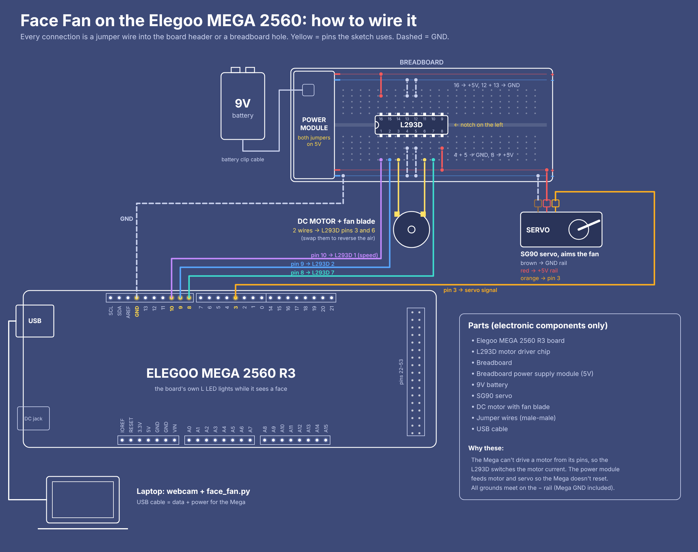

### 3D step-by-step wiring

Open [`wiring/wiring_steps_3d.html`](wiring/wiring_steps_3d.html) in a
browser (download it first) for an interactive 3D view with Back / Next
buttons. The same steps as pictures:

| | |
|---|---|
| **1. Place the chip and the power module** (notch on the LEFT, columns 10–17) 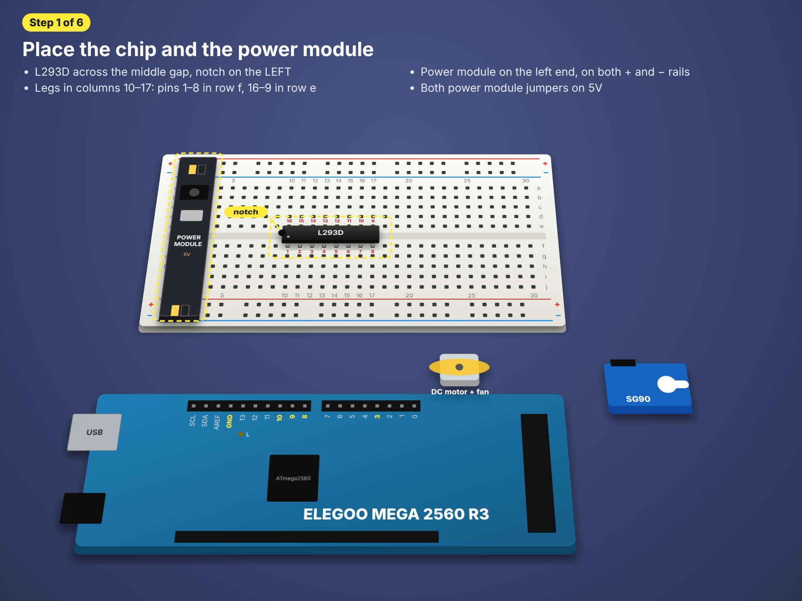 | **2. Power and ground for the chip** 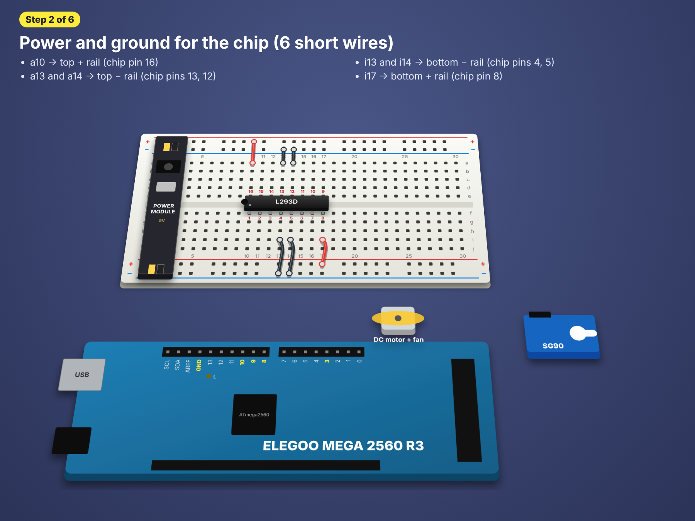 |
| **3. Motor wires** (j12 and j15) 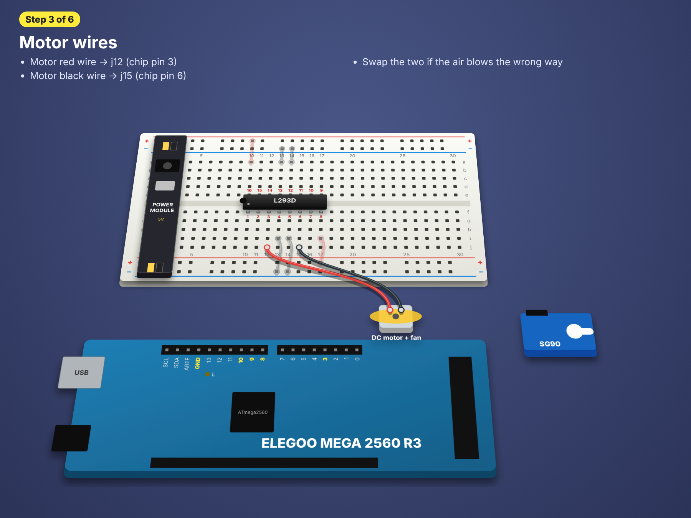 | **4. Mega to chip** (10 → j10, 9 → j11, 8 → j16) 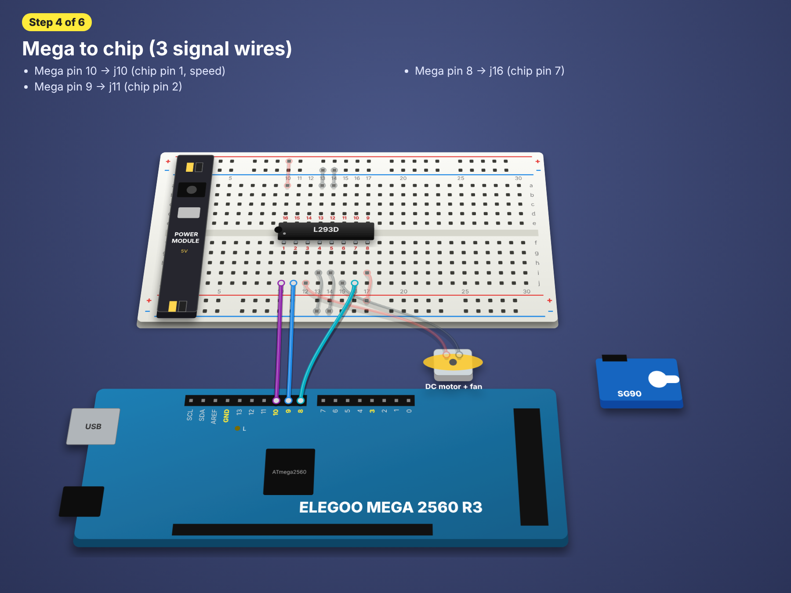 |
| **5. Shared ground** (Mega GND → − rail) 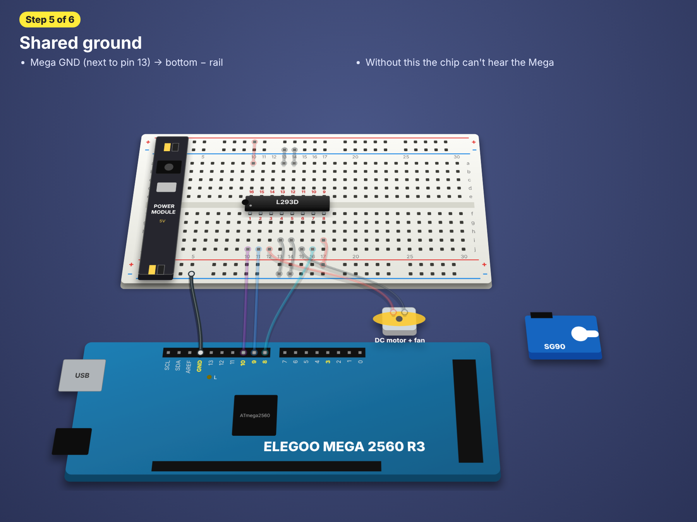 | **6. Servo** (brown −, red +, orange → pin 3) 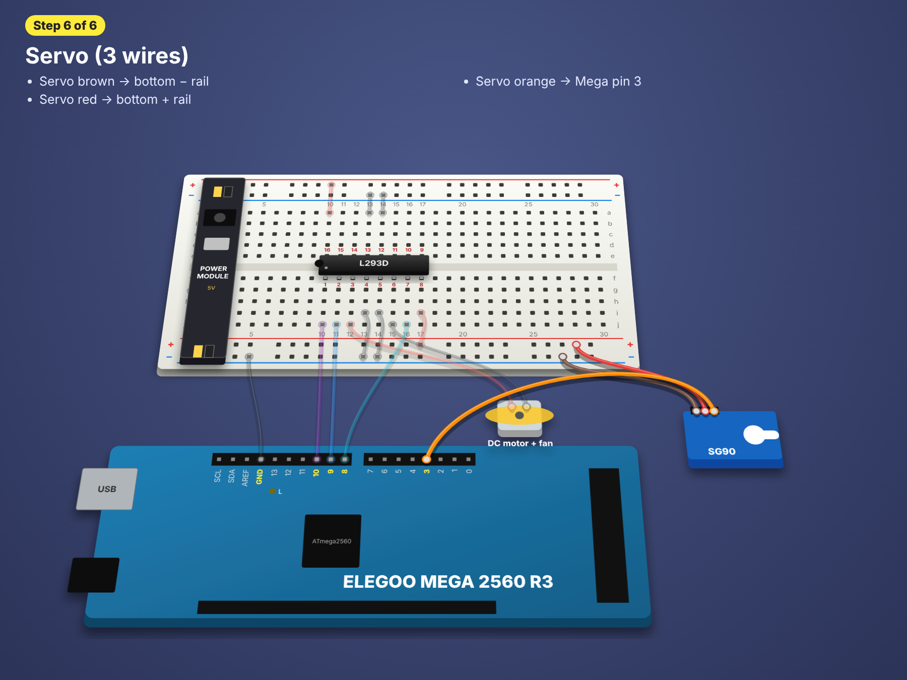 |
| **7. Battery and laptop** 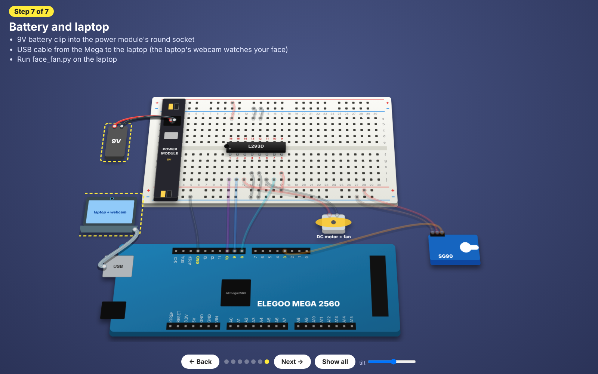 | |

**No battery?** You can power the rails from the Mega instead (USB power,
fine for testing). Take the power module off and add 3 wires: Mega 5V → top
+ rail, top + rail → bottom + rail, Mega GND → top − rail. See
[`wiring/usb-power/`](wiring/usb-power/).

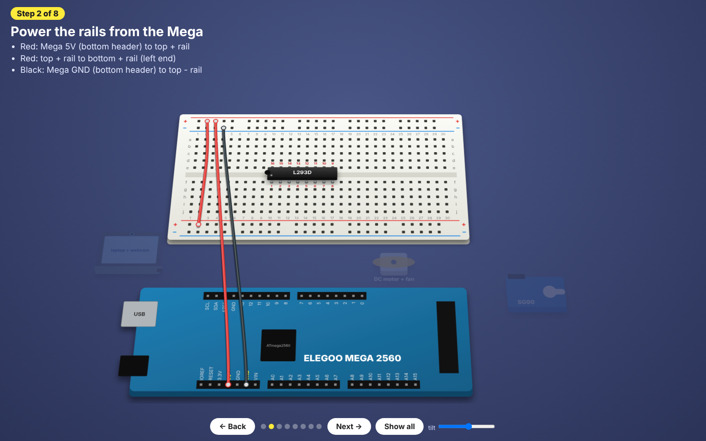

## Setup

### 1. Upload the sketch

1. Install [Arduino IDE 2](https://www.arduino.cc/en/software).
2. Open [`face_fan_mega/face_fan_mega.ino`](face_fan_mega/face_fan_mega.ino).
3. Install the **Servo** library (Library Manager) if the IDE asks for it.
4. Pick the board **Arduino Mega or Mega 2560** and your COM port in the
   board box at the top.
5. Press **Upload** and wait for "Done uploading".
6. Optional check: open the Serial Monitor at **115200 baud**. You should see
   `Face Fan (Mega) v1.0.0 ready`. Type `50,80` and press Enter: the servo centres
   and the fan spins for 2 seconds. **Close the Serial Monitor afterwards.**

### 2. Run the face tracking

```
pip install -r requirements.txt
```

Open [`face_fan.py`](face_fan.py) and set `PORT` to your Mega's COM port
(for example `"COM7"`), then:

```
python face_fan.py
```

A webcam window opens with a green box around your face. Press **q** to quit.
Set `PORT = None` to test the camera without the board.

## How it works

- `face_fan.py` finds the biggest face with OpenCV's built-in Haar cascade
  face detector, smooths its left/right position (0-100) and uses its size to
  pick a fan speed (small face = far away = faster).
- It sends `position,speed` lines like `42,80` at 115200 baud, or `-1` when no
  face is seen, and repeats every half second so the fan keeps running while
  you sit still.
- `face_fan_mega.ino` maps the position to a servo angle and turns smoothly
  towards it. It gives the motor a short full-power kick to start, then sets
  the speed with PWM on pin 10. It stops the fan 2 s after losing your face
  and looks forward again after 5 s.

Settings you may want to change in the sketch:

| Setting | What it does |
|---|---|
| `LEFT_ANGLE` / `RIGHT_ANGLE` | Swap them if the fan turns **away** from you. |
| `MIN_PWM` | Raise (150, 180) if the motor hums but doesn't spin. |
| `FAN_IN1` HIGH/LOW | Swap (or swap the 2 motor wires) to reverse the airflow. |

## Troubleshooting

| Problem | Fix |
|---|---|
| `module 'cv2' has no attribute 'CascadeClassifier'` | OpenCV 5 removed it. Run `pip install "opencv-python<5"`. |
| `Can't open COMx` | Close the Arduino Serial Monitor, check the port number. |
| Camera works, the L LED lights, but nothing moves | The power module is off: press its button (its LED must glow), check the 9V battery, both jumpers on 5V. Some long breadboards have the rails cut in the middle. |
| Burning smell | Unplug at once. Usually 5V touching GND: check that every red wire goes to a **+** rail (if your breadboard is upside down the printed colours are swapped, so go by the power module's + pin), and that the L293D notch points left. |
| Arduino IDE: "arduino-verify-sketch cannot be executed" | A compile was already running. Wait, or press Cancel and Verify once. |

## Versions

The current version is in [`VERSION`](VERSION) and every change is listed in
[`CHANGELOG.md`](CHANGELOG.md). The sketch prints its version when it starts
(`Face Fan (Mega) v1.0.0 ready.` in the Serial Monitor). Download a ready zip
from [Releases](https://github.com/PhamAnhHoangg/ELEGOO-2560-fan-OpenCV/releases):
changing the number in `VERSION` publishes a new release automatically.

## Files

```
face_fan_mega/face_fan_mega.ino   Arduino sketch for the Mega
face_fan.py                       webcam face tracking (Python + OpenCV)
requirements.txt                  Python packages
wiring/                           wiring diagram, 3D steps (PNG + interactive HTML)
media/                            demo videos and logo
VERSION, CHANGELOG.md             version number and change history
```

## Credits

Built by **PhamAnhHoangg**. Claude (an AI assistant by Anthropic) was used as
an assist tool for code suggestions and wiring diagrams.

## License

MIT, see [LICENSE](LICENSE).
